# pending-questions: a Claude Code plugin that keeps unanswered questions in a pane

[](LICENSE)
[](.claude-plugin/plugin.json)
[](https://github.com/anthropics/claude-code)

**pending-questions is a Claude Code plugin (a mod) that keeps the questions Claude asked you from scrolling out of sight.** After each response it extracts the questions that wait for your answer, registers them in a pane beside the chat, and sends your answer back to the session as a prompt. Questions are stored in files, so they survive a session exit or a crash.


*Recorded from a real session. See [About the recordings](#about-the-recordings).*

## Contents

- [Why use pending-questions?](#why-use-pending-questions)
- [Features](#features)
- [How do I install it?](#how-do-i-install-it)
- [How do I answer a question?](#how-do-i-answer-a-question)
- [How do I see questions from other sessions?](#how-do-i-see-questions-from-other-sessions)
- [How does auto mode decide?](#how-does-auto-mode-decide)
- [How do questions close, and how do I correct a mistake?](#how-do-questions-close-and-how-do-i-correct-a-mistake)
- [What happens after a crash?](#what-happens-after-a-crash)
- [How does it work?](#how-does-it-work)
- [Data and cost](#data-and-cost)
- [Limitations](#limitations)
- [FAQ](#faq)
- [About the recordings](#about-the-recordings)
- [Development](#development)

## Why use pending-questions?

Claude Code asks most of its questions as plain text at the end of a response. The next tool output or the next prompt pushes that text up the screen, and nothing reminds you that a question is still open. pending-questions lists open questions in a pane until they are answered, resolved or dismissed, and counts them in the status line.

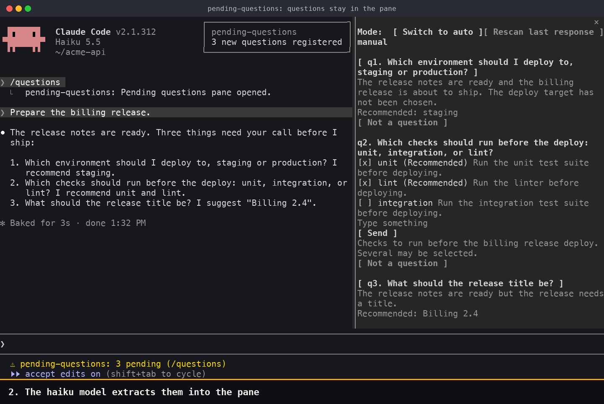

## Features

| Feature | What it does | Demo |
|---|---|---|
| Automatic registration | A small model reads each response and registers the questions and decisions that need your answer | [Overview](#pending-questions-a-claude-code-plugin-that-keeps-unanswered-questions-in-a-pane) |
| Three question kinds | Single choice opens a dialog. Multiple choice shows checkable rows in the pane with the recommended options already checked. Free-form questions show an input with a recommended draft | [Answering](#how-do-i-answer-a-question) |
| Manual and auto modes | Auto mode answers only the questions whose recommendation it can verify in the response, and sends the answer as a plugin message, not as your words. Everything else stays open for you. History shows how each question was handled | [Auto mode](#how-does-auto-mode-decide) |
| Automatic closing | A question closes as `[resolved]` when the conversation or a tool result settles it. The model must quote the evidence, and the plugin checks that quote against the conversation | [Closing](#how-do-questions-close-and-how-do-i-correct-a-mistake) |
| Corrections | `Not a question` closes a wrong entry, `Reopen` restores a wrongly closed one, and `Rescan last response` reads the last response again with a stronger model | [Corrections](#how-do-questions-close-and-how-do-i-correct-a-mistake) |
| Crash recovery | Questions, unread responses and undelivered answers are written to disk first, so a restart continues where the session stopped | [Crash recovery](#what-happens-after-a-crash) |
| Other sessions | The pane lists open questions in other sessions with the same working directory, with the `claude --resume` command for each | [Other sessions](#how-do-i-see-questions-from-other-sessions) |

## How do I install it?

At the Claude Code prompt:

```
/plugin install pending-questions --marketplace hwanyong/pending-questions
```

In a shell:

```
claude plugin install pending-questions --marketplace hwanyong/pending-questions
```

Plugin changes apply after Claude Code restarts. To update or remove it:

```
claude plugin update pending-questions@pending-questions
claude plugin uninstall pending-questions@pending-questions
```

## How do I answer a question?

The pane opens when a session starts in a terminal at least 144 columns wide. `/questions` opens it at any width, and opens it again after you close it.

Press `ctrl+x` then `Tab` to move keyboard focus to the pane, `Tab` to move between controls, and `Enter` to press one. The same `ctrl+x` then `Tab` returns focus to the prompt.

| Question kind | How you answer |
|---|---|
| Single choice | Press the question to open a dialog. Five or more options are split into pages with `More options` |
| Multiple choice | Toggle the rows, optionally type an addition, then press `Send` |
| Free-form | Edit the recommended draft and press `Enter` |


Single choice opens a dialog with the recommended option first:

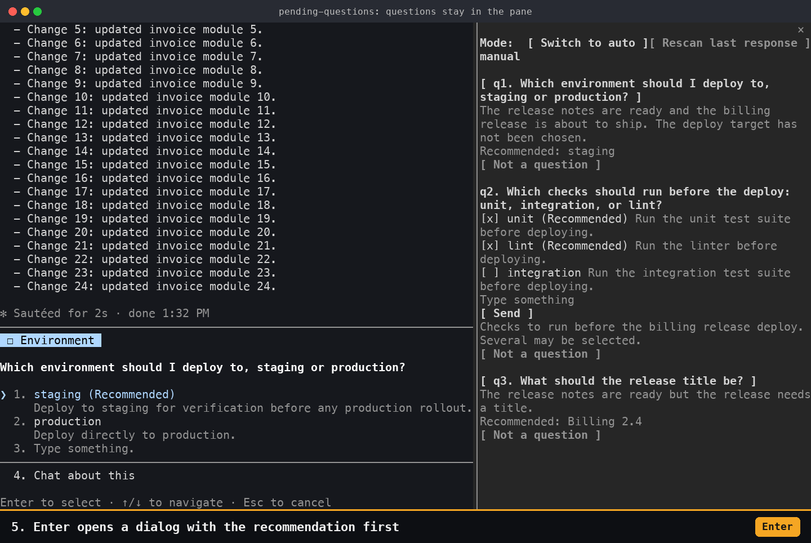

With five or more options, `More options` moves to the next page:

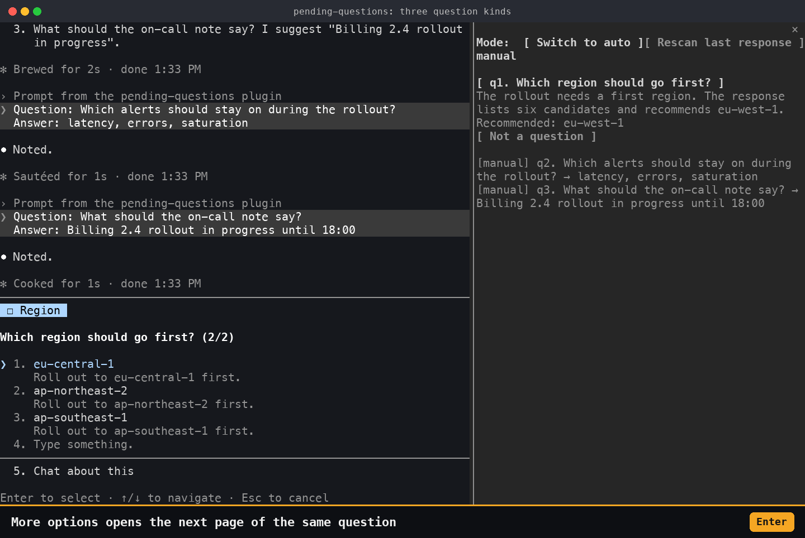

Multiple choice shows rows in the pane, with the recommended options already checked:

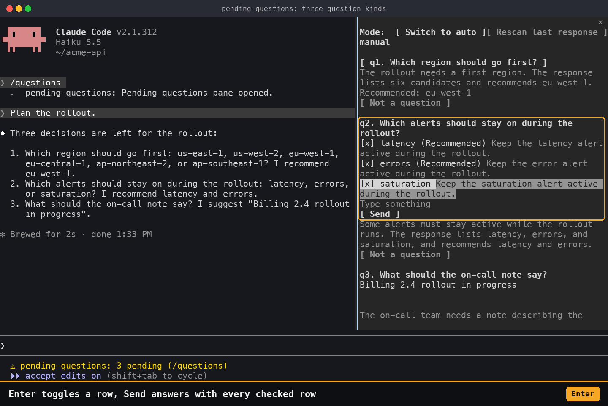

Free-form shows an input that holds a recommended draft:

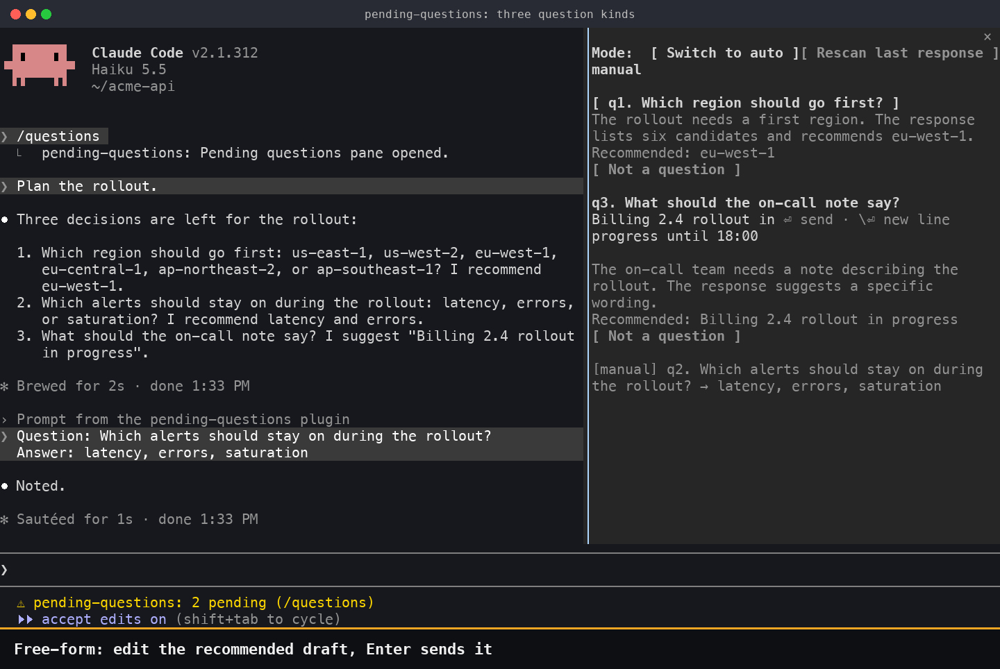

History marks each closed question:

| Mark | Meaning |
|---|---|
| `[manual]` | You answered it |
| `[auto]` | Auto mode sent the recommendation stated in the response |
| `[resolved]` | The conversation or a tool result settled it |
| `[dismissed]` | You pressed `Not a question` |

## How do I see questions from other sessions?

The pane lists other sessions in the same working directory that still have open questions, with the command to resume each one.

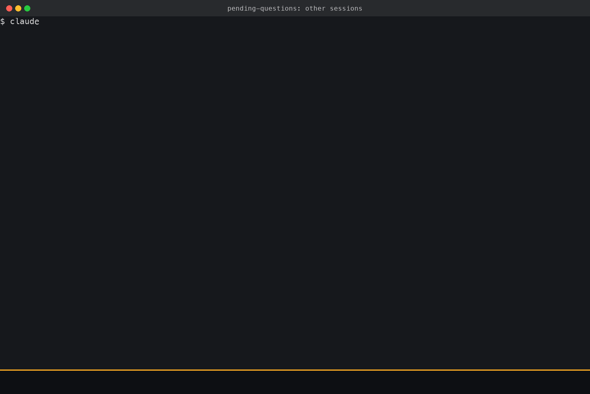

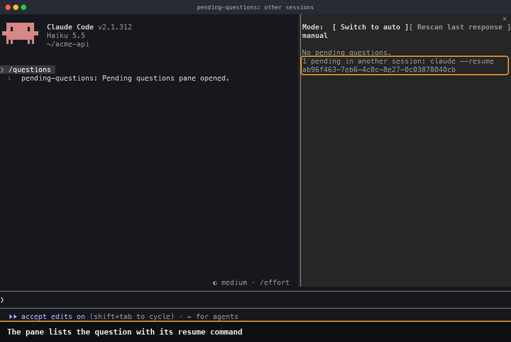

## How does auto mode decide?

Auto mode answers a question only when the response itself recommends an answer. Otherwise the question stays open with a note in the pane. Manual mode is the default. Press `Switch to auto` in the pane to turn auto mode on.


An answered question, framed as a message from the plugin:

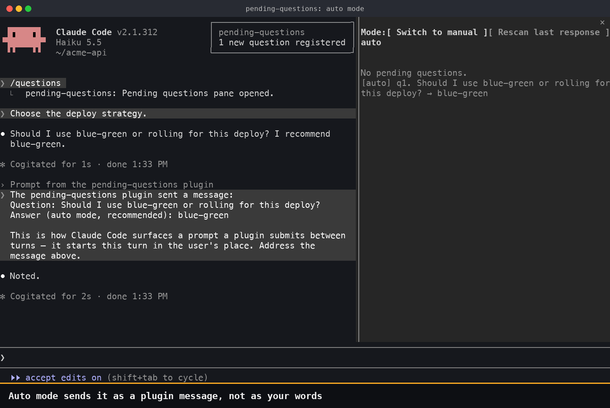

A question with no recommendation stays open:

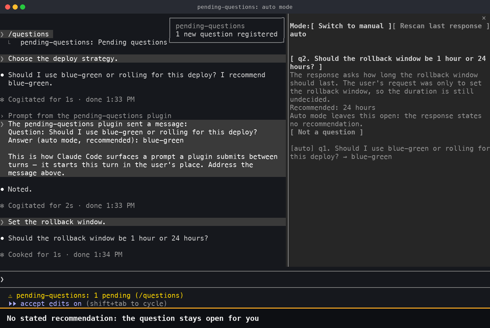

Auto mode answers without showing you the question, so it has these limits:

- It answers only when the response itself recommends an answer. The extraction model must quote the question and the recommendation, and the plugin uses each quote only to find a whole sentence in the response. Blockquotes, code blocks and HTML blocks are left out, because those usually relay text from elsewhere, and a response with a code fence inside a list, a quote or an indent counts as having no recommendation.
- The question sentence must appear once and contain exactly one question mark. The recommendation sentence must come after it, with no other question between them.
- The recommendation sentence must contain the chosen label as a whole word (at least 2 characters), in the same capitalization, and a direct recommendation (`I recommend`, `we suggest`, `I prefer`, `recommended`, `recommendation`, `권장`, `추천` or `권합`). It must not contain another option's label, a question mark, text after a sentence that ends inside a quote, parentheses, a code span or emphasis, or a negation, comparison or condition word such as `not`, `over`, `if`, `않` or `비추천`.
- Any other question stays open, with a note in the pane. That includes every recommendation written in another language and sentences that name both options, such as "A 와 B 중 A 를 권장합니다".
- Verdicts saved under an earlier version of these checks are not trusted: those questions return to you.
- The text it sends uses the question sentence from the response, not the question the model wrote, and History shows that sentence. Claude reads it framed as `The pending-questions plugin sent a message:`, not as something you said. Answers you give yourself are sent as your words.
- A question Claude asks through the `AskUserQuestion` tool is answered only when every question in the call has an option marked `(Recommended)`. Otherwise the dialog opens.
- After 5 automatic answers in a row it pauses until you type a prompt or answer a question.

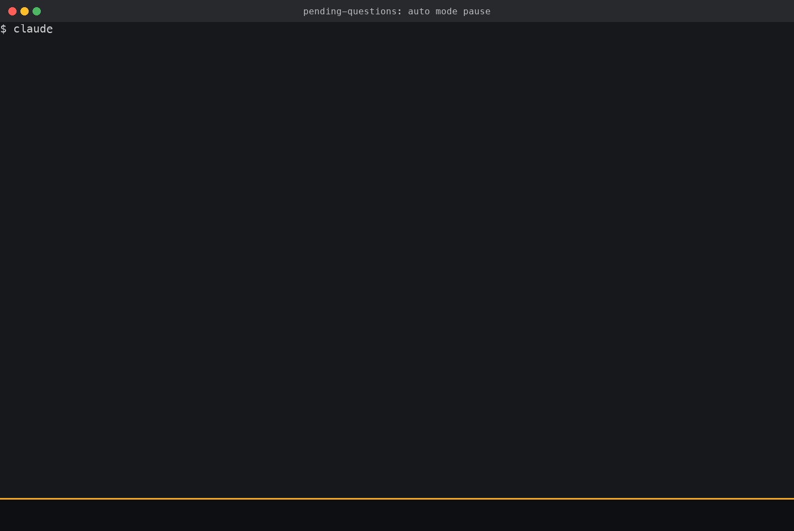

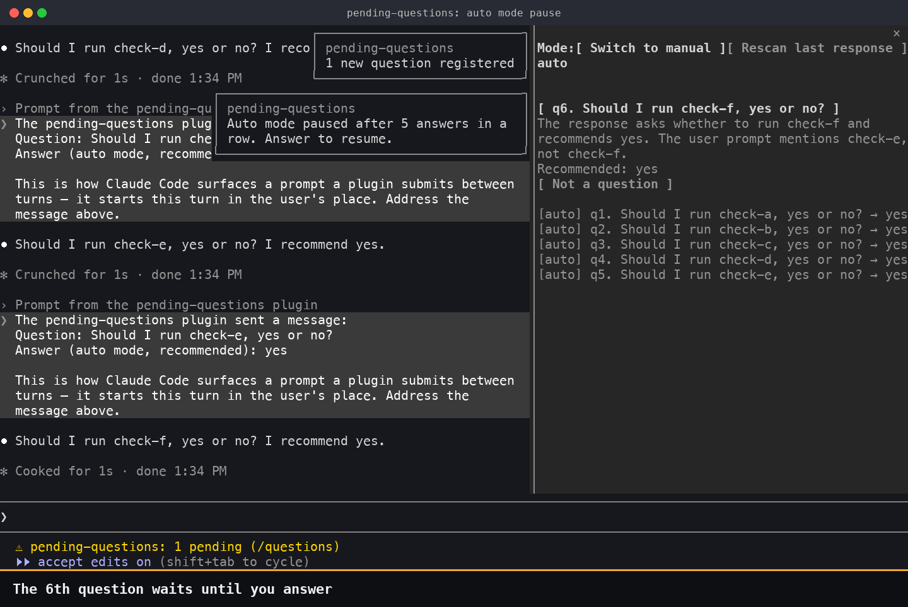

## How do questions close, and how do I correct a mistake?

A question closes as `[resolved]` when the conversation or a tool result settles it, for example when you answer in the chat instead of the pane. `[resolved]` entries show the quoted evidence and a `Reopen` button.

Extraction is done by a model and can be wrong, so each wrong result has a control in the pane:

| Wrong result | Control |
|---|---|
| Something that is not a question was registered | `Not a question` |
| A question was closed wrongly | `Reopen` |
| A question was missed | `Rescan last response`, which uses the `sonnet` model |


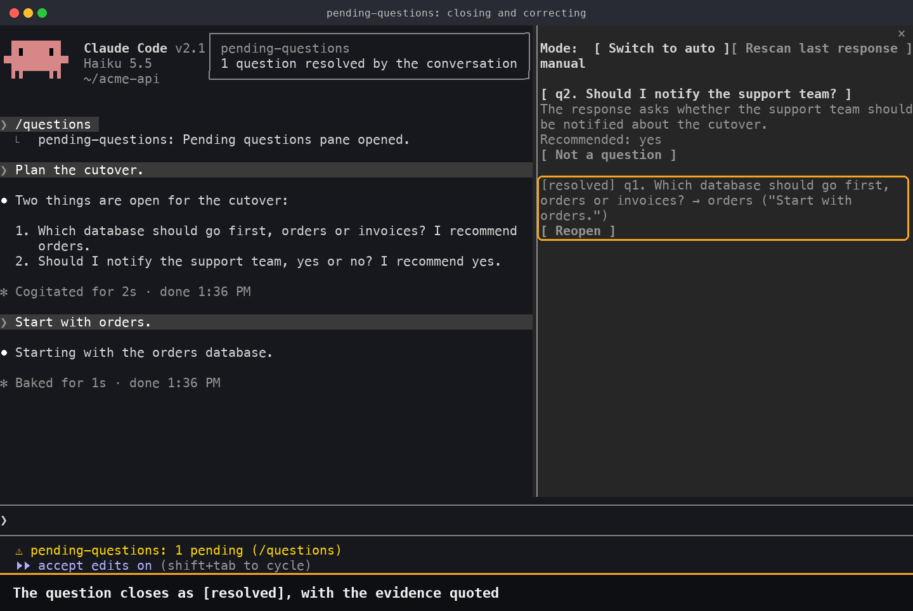

## What happens after a crash?

The question is still there. Questions, unread responses and undelivered answers are written to a file before anything else happens, so resuming the session restores them. On restart, undelivered answers are compared with the conversation record so none is sent twice.

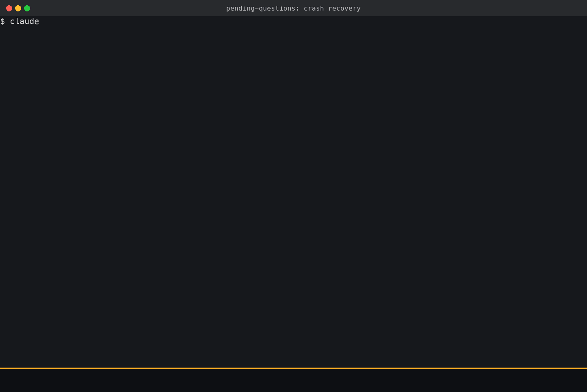

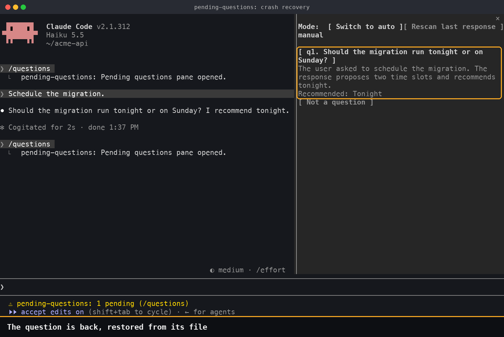

## How does it work?

1. When a turn ends, the response is written to a file as unread.
2. The `haiku` model extracts new questions and resolved ones. `Rescan last response` uses the `sonnet` model.
3. The answer is written to the file, then submitted to the session as a prompt. On restart, undelivered answers are compared with the conversation record so none is sent twice.

Each session writes to two files in turn, `<sessionId>.0.json` and `<sessionId>.1.json`, in `~/.claude/pending-questions/`. A write interrupted halfway leaves the previous version intact. After each write, `hooks/flush.pl` asks the operating system to commit the file and its folder to disk (`F_FULLFSYNC` on macOS, `fsync` elsewhere). If that fails, the plugin shows a toast and keeps the written file.

## Data and cost

- Each response, the user prompt and a part of the turn's tool output are sent to the extraction model through your Claude Code session. Extraction uses your account's usage on every response that ends a turn. The amount has not been measured.
- Question files are plain JSON in `~/.claude/pending-questions/`. They contain question text, answers and unread responses.

## Limitations

- Extraction is done by a model, so it can miss a question, register something that is not one, or close one wrongly. The corrections above undo these; they do not prevent them.
- The label comparison is case-sensitive. When the extraction model writes `Blue-green` and the response says `blue-green`, the question stays open with the note `the response states no recommendation`, although the response states one. This happened in 2 of the last 5 recording runs of the auto mode scene.
- Auto mode checks words and sentence positions, not meaning. No word list is complete. A sentence that passes the checks above but means something else is still sent, including text Claude relays as plain prose and a recommendation attributed to someone else ("the docs recommended a.txt"). Use auto mode only where a wrong answer is cheap to undo.
- The extraction input includes the turn's tool output, because a tool result can settle a question. The input is marked as data with randomized tags, but a file or web page that Claude read could still mislead the extraction model into registering or closing a question wrongly. Auto mode does not send such a question unless both quotes pass the check above; check the pane for entries you do not recognize.
- Recovery was tested with `kill -9`. A real power loss or reboot has not been tested. Whether data survives also depends on the drive honoring the flush.
- Tested on macOS with Claude Code 2.1.312 in a terminal. Not tested: Linux, Windows, mobile (where free-form questions fall back to a dialog with `Decide later`), the desktop app and `claude --bg`.
- `hooks/flush.pl` needs `perl` on the `PATH`. Without it, every write shows a toast and the files are still written.

## FAQ

### What is pending-questions?

A Claude Code plugin that lists the questions Claude asked and you have not answered yet in a pane beside the chat. It finds them with a small model after each response, sends your answer back as a prompt, and stores them in files that survive a crash.

### How do I stop losing track of questions in Claude Code?

Install pending-questions. Every question a response leaves open stays in the pane and is counted in the status line until you answer it, the conversation settles it, or you press `Not a question`.

### Does it replace the AskUserQuestion tool?

No. `AskUserQuestion` still opens its dialog when Claude calls it. pending-questions covers the questions Claude writes as plain text. In auto mode it also answers an `AskUserQuestion` call, but only when every question in the call has an option marked `(Recommended)`.

### Can Claude Code answer its own questions automatically?

Only in auto mode, and only when the response states a recommendation that passes the checks in [How does auto mode decide?](#how-does-auto-mode-decide). The answer reaches Claude as a plugin message, not as your words, and auto mode pauses after 5 answers in a row. Manual mode is the default. Use auto mode only where a wrong answer is cheap to undo.

### Does it use my Claude usage?

Yes. Extraction calls the `haiku` model through your session on every response that ends a turn, and `Rescan last response` calls `sonnet`. The amount has not been measured.

### Where are my questions stored?

In plain JSON files at `~/.claude/pending-questions/<sessionId>.<0|1>.json` on your machine. The files contain question text, answers and unread responses.

### Are questions lost when Claude Code crashes?

Not in the `kill -9` test: resuming the session with `claude --resume` restored the open questions. A real power loss or reboot has not been tested.

### Can I choose where the pane appears?

No. Claude Code chooses the position, and the plugin API has no option for it: beside the transcript in fullscreen from 110 columns, otherwise above the prompt. When several plugin panes are open, one is shown and the others become tabs.

### Which platforms does it support?

It was tested on macOS with Claude Code 2.1.312 in a terminal. Linux, Windows, mobile, the desktop app and `claude --bg` have not been tested.

## About the recordings

The animated images are APNG files recorded from real Claude Code 2.1.312 sessions running this plugin at version 0.1.4 with the `haiku` model. The terminal was captured with `tmux capture-pane -e` and drawn to images by [`verification/demo/`](verification/demo/).

- Claude's responses were fixed with a system prompt (`--append-system-prompt-file`) so that the recording repeats. Extraction, the pane, dialogs, automatic answers and `kill -9` recovery ran for real.
- A take was recorded again when it stopped, including when the case-sensitive label check above left the first question open. The images show takes where it passed.
- Waits were shortened. The title bar, the strip under the terminal and the orange outlines are not part of the interface.
- Lines from Claude Code that are not about this plugin (account plan, usage notices, tips, promotions) were removed from the images.
- The project names and the questions are fictional.

## Development

```
claude --plugin-dir .
npx -y -p typescript tsc -p .
claude plugin validate .
```

Design decisions, measured engine constraints and test records are in [docs/handoff.md](docs/handoff.md) (Korean). The procedure for recording the images again is in the same file. Keep `--debug-file` logs outside the plugin folder: the symlink it creates there can stop `/questions` when the folder is on an SMB share.

## License

[MIT](LICENSE)
